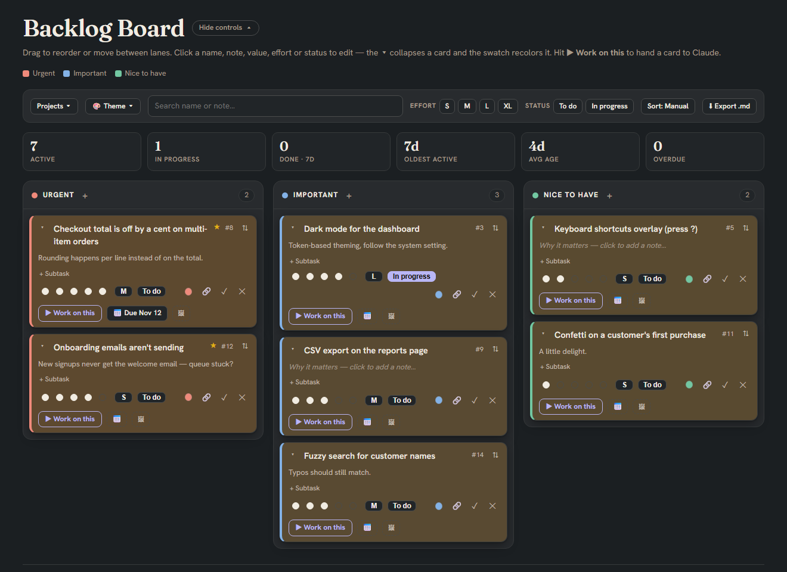

# Backlog Board

[](https://github.com/kasperjunky/Backlog-Board/actions/workflows/ci.yml)

A private, per-project backlog for Claude Code. Defer a task in plain language and
Claude captures it; say **"show backlog"** and Claude opens a colorful drag-and-drop
Kanban board of everything you've saved for that project.



**Install** (two steps — [full details below](#install)):

```
/plugin marketplace add kasperjunky/Backlog-Board
/plugin install backlog@backlog-board
```

- **Capture by talking.** Say *"save to backlog: X"* (or just defer something — "later",
  "let's do that another time") and it's filed with a priority, value, effort, and an
  optional note on why it matters, and it syncs onto the board right away. Near-duplicates
  are skipped.
- **A real board, not a list.** "Show backlog" opens a Kanban board with three priority
  lanes (Urgent / Important / Nice to have) plus an Archive. Drag cards to reorder or
  re-prioritize, click to edit the name, note, value, effort, or status, and mark cards
  done to archive them.
- **Due dates.** Give a card a date with 📅; it turns amber when it's close and red when
  overdue, and an *Overdue* tile counts them. Search, filters and sort are remembered in
  your browser, and the archive offers to clear cards finished more than 30 days ago.
- **Quick commands.** `/backlog` shows your board's link and anything not on it yet;
  `/backlog add <task> !urgent` captures without asking Claude (`!important`, `!nice` work
  too); `/backlog done #12 Shipped` closes a card and `/backlog note #12 …` adds to its note;
  `/backlog issue #12` turns a card into a GitHub Issue (you see the draft first);
  `/backlog inbox` lists captures waiting to sync.
- **Nothing gets lost.** If a capture hasn't reached the board yet, a line under the prompt
  says so (e.g. *2 backlog items not on the board yet — say "show backlog" to sync*) and
  clears itself once they're synced.
- **Hand work back to Claude.** Click **▶ Work on this** on any card and tell Claude
  *"start my backlog pick"* — Claude reads what you picked and starts working on it.
- **Private and per-project.** Captures live in a per-project file under your home
  (`~/.claude/backlogs/`), never inside the repo you're working in. Each project gets
  its own board.

## Using the board

### Quick start

1. **Install the plugin** (see [Install](#install)) and open Claude Code in your project.
2. **Send any message.** On the first one, Claude sets up a private board for the project
   (you approve one publish) and, if it finds open tasks written down already — in its
   memory for the project, `CLAUDE.md`, or a `TODO`, `BACKLOG` or `ROADMAP` file — shows
   you the list and adds the ones you pick. A line under the prompt says this is coming.
3. **Capture something.** Say *"save to backlog: add dark mode, it's the top user request"*,
   or type `/backlog add Add dark mode !important`. *"show backlog"* opens the board any time.
4. **Hand a card back.** On the board, click **▶ Work on this** on a card, then tell Claude
   *"start my backlog pick"*. When Claude finishes, the card moves to the Archive with a
   ✓ line saying what was done.

### What to say to Claude

| Say… | What happens |
| --- | --- |
| *"save to backlog: …"*, *"later"*, *"let's do that another time"* | Captures a task (Claude fills in priority, value, effort and the reason you gave) and syncs it to the board. Near-duplicates are skipped or flagged. |
| *"show backlog"* / *"open the board"* | Opens the board, bringing in anything not on it yet. |
| *"import my backlog"* | Reads Claude's memory for the project and its notes files for open tasks, shows you the candidates with a suggested priority, and adds the ones you pick. Runs by itself the first time; duplicates are skipped. |
| *"start my backlog pick"* (the board says *"start my pick"* — either works) | Claude reads the card you picked, says which one it's starting, and gets to work. |
| *"work on the dark mode item"* | Same, for a card you name instead of picking. |
| *"do item #23"* / *"work on #A4"* | Same, for the card with that number on the board. |
| *"sync projects"* / *"update the project switcher"* | Refreshes the **Projects ▾** list from all your project boards. |
| *"upgrade my board"* | Republishes this project's board from the current page, keeping its name. Normally you never need it: see [Board updates](#board-updates). |

### Board updates

Each project's board is its own private Artifact, a published copy of the board page that
ships with the plugin. Updating the plugin does not touch boards that already exist, so
the plugin keeps a fingerprint of the page each board was published from. When an update
ships a different page, a line under the prompt says *Your board is older than this
plugin*, and Claude republishes that project's board at the start of your next message
(one permission prompt for the publish), then carries on with what you asked. Cards,
comments, images, picks and the theme live in the board's database and survive. A shared
team board is updated once by its owner and everyone gets it. Boards made before
images existed (6 Nov 2026 or earlier) get images this way too.

**Images are part of the task.** Whenever Claude starts a card — picked, named or by number —
it looks at every image attached to it (screenshots, mockups) before starting, and says in
its first line what they show.

### Slash commands

| Command | What it does |
| --- | --- |
| `/backlog` | Shows your board's link and anything not on it yet. |
| `/backlog add <task> [!urgent \| !important \| !nice]` | Captures right away, without asking Claude (default lane: Important). |
| `/backlog inbox` | Lists captures that haven't reached the board yet. |
| `/backlog import` | Pulls open tasks out of your notes (Claude's memory for the project, `CLAUDE.md`, `TODO`/`BACKLOG`/`ROADMAP` files) onto the board, after you confirm the list. |
| `/backlog done #X [what was done]` | Closes card #X on the board at Claude's next message — status done, finished today, and the text (if given) as its ✓ result line. `/backlog close` is the same. |
| `/backlog note #X <text>` | Appends the text to card #X's note on the board at Claude's next message. |
| `/backlog issue #X [context]` | Promotes card #X to a GitHub Issue in this repo: Claude drafts it from the card (name, note, subtasks as a task list, comments), shows you the draft, and on your yes runs `gh issue create`, then puts the issue URL on the card as its 🔗 link. Needs the `gh` CLI, signed in. `/backlog promote` is the same. |
| `/backlog use` | Shows which board this project uses. `/backlog use repo` joins the team board linked in the repo, `/backlog use <board link>` uses any shared board, `/backlog use own` goes back to your own. |
| `/backlog team` | Makes this project's board the repo's team board (see [Team boards](#team-boards)). |
| `/backlog help` | Lists the commands. |

### A tour of the board

**? Help**, next to the board's name, opens this tour on the board itself, so anyone the
board is shared with can read it without installing anything.

**Lanes.** Cards sit in three lanes — **Urgent**, **Important**, **Nice to have** — plus an
**Archive** at the bottom for finished cards. Click the **+** next to a lane's name to add a
card there (Enter adds it and keeps the box open for another; Esc closes it). From the
keyboard, press **N** to open that box in the lane you're on (the lane of the focused card
or **+**); with focus elsewhere it opens the lane you last added to, or Urgent.

**Card numbers.** Every card gets the next running number, whether Claude captured it or you
added it on the board: **#1 … #999**, then **#A1 … #A999**, **#B1** and so on (after #Z999
comes #AA1). A card added on the board shows its number a moment after it appears.

**Editing a card.** Everything on a card is clickable:

- **Name** and **"Why it matters" note** — click to edit, Enter to save.
- **Value** (the five dots) — how worthwhile it is, 1–5. Click the current dot again to lower it.
- **Effort** (S / M / L / XL) — click to cycle.
- **Status** (*To do* / *In progress*) — click to toggle.
- **+ Subtask** — adds a checklist with a progress bar. Tick items off, click one to rename
  it, ✕ to remove it.
- **💬** — open the card's comment thread. Anyone who can use the board can add a comment
  (Enter posts it); each shows who wrote it and when; you can remove your own (the board's
  owner can remove any). On a team board this is how you talk about someone else's card
  without rewriting their note, and Claude reads the thread when it picks the card up.
- **📅** — set a due date. The chip reads *Due Jan 12*, turns amber within 3 days (*Due
  tomorrow*), and red once it's past (*Overdue 4d*). Click it to change or remove the date.
- **🔗** — attach a link (a PR, issue, commit or branch). It shows as a short chip like
  *PR #12* or *commit abc1234*. Only `http(s)` links are accepted.
- **🖼** — add images (PNG, JPEG, GIF or WebP, up to 10 MB each, 8 per card). You can also
  **drop** image files onto a card or **paste** a screenshot while editing one. Thumbnails
  appear under the note; click one to view it full size (← → to step through, Esc to close).
  Remove one with its ✕ (asks first). When you hand a card with images to Claude, it looks at
  them too.
- **●** (the colored dot) — recolor the card from a palette or a custom color; *Default*
  goes back to the lane color.
- **▾** — collapse the card to just its name.
- **✓** — mark it done (it moves to the Archive). **✕** — delete it. The card goes at once and a
  toast offers **Undo** for 10 seconds; Undo puts it back exactly as it was, number and images
  included.

**Moving cards.** Drag a card to reorder it or drop it in another lane. On a phone, tablet or
keyboard, use the **⇅** button at the card's top right instead: it opens **↑ Up**, **↓ Down**
and buttons for the other lanes. With the keyboard, **Alt+↑ / Alt+↓** moves the card you're
on, and **N** opens a new card in its lane. Moving is paused while a search, filter or the quick-wins sort is on, so the order you
see is always the real one.

**Picking a card for Claude.** **▶ Work on this** marks the card *📌 Picked for Claude* and
shows a bar at the top; tell Claude *"start my backlog pick"*. **Clear** un-picks it.

**The toolbar.**

- **🎨 Theme ▾** — recolor the whole board: *Warm* (the default — cream in light mode, a slate
  page with warm brown cards in dark mode), *Ocean*, *Forest*,
  *Grape*, *Mono* or *High contrast*, plus **Auto / Light / Dark** (Auto follows your system
  or Claude's own light/dark setting). The choice is saved on the board, so it looks the
  same on every device and for anyone you share it with. Every palette meets contrast
  guidelines in both light and dark. Under **Custom colors** you can also pick your own
  **Background** (the page, lane panels, tiles and menus follow it) and **Cards** color, on
  top of any palette — kept separately for light and dark mode, with **Reset** to undo and a
  warning if a color would make text hard to read.
- **Projects ▾** — jump to another project's board. The list is refreshed whenever you open
  the backlog or say *"sync projects"*.
- **Search** — matches card names and notes.
- **Effort** and **Status** filters — show only the cards you pick; *Showing N of M* says how
  many are hidden. **Clear filters** resets them.
- **Sort: Manual / Quick wins ★** — *Quick wins* orders each lane by value ÷ effort (S counts
  1, M 2, L 3, XL 4). Cards scoring 2.5 or more get a ★ either way.
- **⬇ Export .md** — downloads the whole board as `backlog.md` (or shows it to copy).
- **Hide controls / Show controls** (next to the title) — folds away the intro, toolbar and
  stats so the lanes start at the top. While folded it says *filters on* if anything is
  filtering the board.

Your search, filters, sort and the folded/unfolded state are remembered in your browser.

**Stats.** The strip above the lanes shows **Active**, **In progress**, **Done · 7d**,
**Oldest active** (red at 14 days or more; hover for its name), **Avg age**, and **Overdue**
(hover for the names).

**Archive.** Finished cards, newest first, each with its note and Claude's ✓ result line
(any links in it are clickable).
**↺** puts a card back on the board; **✕** deletes it, with the same 10-second **Undo**. When cards were
finished more than 30 days ago, a **Remove N cards done more than 30 days ago** button
clears them in one go (also asks first).

**Reminder under the prompt.** If something you captured hasn't reached the board yet,
Claude Code shows a line like *2 backlog items not on the board yet — say "show backlog" to
sync*. It disappears once they're synced.

### Team boards

One board can be shared by a whole team: everyone captures into it, picks cards for their
own Claude, and sees who added what and who's on it.

**To set one up** (the board's owner, once):

1. In the project, run `/backlog team`. It writes `.claude/backlog-board.json` with the
   board's link, and Claude marks the board as a team board.
2. Commit that file.
3. In claude.ai, open the board's **Share** menu and add your teammates as people who can
   **use** it (Contributors).

**To join** (each teammate, once): install the plugin, open the project, and run
`/backlog use repo`. Until you do, a line under the prompt says *This repo links a team
backlog board — run /backlog use repo to join it*; your captures stay on your own board.
You can also join any board you've been given with `/backlog use <board link>`.

**On a team board:**

- **👤 Assignee.** Click 👤 on a card to assign it — to yourself, someone already on the
  board, or anyone you find by name. *▶ Work on this* assigns the card to you.
- **Added by.** Cards someone else added say *by Ana*.
- **Mine.** A toolbar filter that shows only the cards assigned to you.
- **Your own pick.** Each person's *▶ Work on this* pick is private to them, so teammates'
  picks never overwrite each other.
- **Who can change what.** Anyone the board is shared with as a Contributor can add, edit,
  move and delete cards. The theme, colors and project list can be changed only by the
  owner and Editors; others can preview a theme without saving it.
- **Numbering.** Every card — captured through Claude or added on the board — takes the next
  number from one counter on the board, so two people never get the same #. If two ever
  clash, the board renumbers the newer card on its own.

These controls appear only when a board is shared — on a board only you use, nothing
changes.

## Requirements

- **Claude Code** with support for plugin hooks modules ("mods"). Tested with Claude Code
  2.1.278 (CLI) and 2.1.309 (desktop app).
- **A claude.ai sign-in.** The board is a private claude.ai Artifact with a small database,
  so Claude needs to be able to publish artifacts in your session. Capturing (`/backlog add`,
  "save to backlog") works without a board; the board appears the first time you say
  *"show backlog"*.
- **Nothing else to install** — no npm packages, servers or accounts. (For development only:
  the board tests need Chrome or Edge.)

## Install

Installing is two steps: add this repository as a plugin marketplace, then install the
`backlog` plugin from it (the marketplace is called `backlog-board`). From a shell:

```
claude plugin marketplace add kasperjunky/Backlog-Board
claude plugin install backlog@backlog-board
```

Or the same two commands at the prompt of a terminal Claude Code session:

```
/plugin marketplace add kasperjunky/Backlog-Board
/plugin install backlog@backlog-board
```

In the desktop app (where `/plugin` doesn't run): click **+** next to the prompt box →
**Plugins** → **Add marketplace** with `kasperjunky/Backlog-Board` → **Add plugin**.

Then **start a new Claude Code session** in any project — the plugin loads when a session
starts. Say *"save to backlog: try the backlog board"*, then *"show backlog"*.

To update later, run these two from a shell, then start a new session (plugin updates are
never automatic — the installed copy stays at its version until you do):

```
claude plugin marketplace update backlog-board
claude plugin update backlog@backlog-board
```

> If you install from a **private copy** of this repository (a fork, or before it was made
> public), only people it's shared with on GitHub can install it, and they also need a
> github.com git credential on their machine (an SSH key, or `gh auth login` followed by
> `gh auth setup-git`).

## Using it in Cursor

There are two ways, and you can use both.

### Claude Code inside Cursor

Cursor runs the **Claude Code extension** like any VS Code-based editor. Install the Claude
Code extension in Cursor, then install this plugin from Cursor's terminal with the two
commands under [Install](#install). Everything works as in any Claude Code session —
captures, `/backlog`, the board, picks — because it *is* Claude Code.

### Cursor's own AI (Agent and Chat)

Cursor's built-in AI can't reach a claude.ai board, so the plugin ships a small **MCP
server** that lets it capture tasks into the same private backlog. Captures wait in your
inbox and land on the board the next time Claude Code syncs (Claude Code's status line points
them out; say *"show backlog"* there).

**Set up a project** — from the project's folder, with [Node.js](https://nodejs.org) 18 or
newer installed (no Claude Code needed for this part):

```
npx -y github:kasperjunky/Backlog-Board#backlog--v0.11.2 setup
```

That writes two files into the project's `.cursor/` folder (keeping anything already there):

- `.cursor/mcp.json` gains a `backlog` server, pinned to the release that ran `setup` (so
  teammates run that reviewed version, never whatever `main` is today; re-run `setup` to
  move to a newer release):

  ```json
  {
    "mcpServers": {
      "backlog": {
        "command": "npx",
        "args": ["-y", "github:kasperjunky/Backlog-Board#backlog--v0.11.2", "--project", "${workspaceFolder}"]
      }
    }
  }
  ```

- `.cursor/rules/backlog.mdc`, a rule telling Cursor's AI when to capture.

Then open **Cursor Settings → MCP** and make sure **backlog** is enabled (reload the window if
it isn't listed). Commit both files if your team uses Cursor too.

**Then just talk to Cursor's AI**: *"save this for later: add CSV export"*, or *"do item #24"*.
It gets these tools:

| Tool | What it does |
| --- | --- |
| `backlog_add` | Captures a task (name, priority, value, effort, notes), skipping duplicates. |
| `backlog_item` | One card by its board number (`24`, `#24`, `#A1`): its text **and its images**, so Cursor's AI sees your screenshots and mockups. |
| `backlog_cards` | Lists the board's open cards. |
| `backlog_inbox` | Lists captures not on the board yet. |
| `backlog_board` | Gives the board's link to open in a browser. |

**Cards and images for Cursor.** Cursor can't reach the claude.ai board, so Claude Code keeps a
local copy of the open cards and their images (in `~/.claude/backlogs/<project>/`). In a
project set up for Cursor, Claude refreshes it every time it syncs the board; say *"sync the
backlog for Cursor"* in Claude Code to refresh it on demand (do it once after setup).
`backlog_item` tells Cursor when a card or image isn't in the copy yet.

It uses the same backlog file as Claude Code for that project, so the two never drift apart,
and it follows the same rules: duplicates are skipped, a damaged file is never overwritten,
and a team board linked in the repo is only mentioned, never used without `/backlog use repo`.

## How it works

The plugin is a hooks module. On session start it registers an `add` tool (how captures
are filed) and a `/backlog` command, and it tells Claude where your private backlog file
lives and how to sync captures onto your board. The board UI ships with the plugin
(`board.html`); the first time you say "show backlog" in a project, Claude publishes it as
a private claude.ai Artifact with a small shared database and remembers its link.

## Security

- **Your items are private, and never in a repo.** Captures live in a per-project file under
  your home (`~/.claude/backlogs/`), which isn't a git repo, so they can't be committed. The
  board is a **private** claude.ai Artifact — only you can open it until you share it from its
  Share menu. The only things the plugin ever writes into a project are config, never card
  text: `.claude/backlog-board.json` (just the team board's link) and, for Cursor,
  `.cursor/mcp.json` plus a capture rule. For Cursor, Claude Code also keeps a local copy of
  the open cards and their images under `~/.claude/backlogs/<project>/` so Cursor's AI can read
  them — on your own machine, outside any repo. (If you commit `.claude/backlog-board.json` to
  a public repo, the board *link* is visible, but the board itself stays private and
  unopenable to anyone you haven't shared it with.)
- **Board text is treated as data.** Claude is told never to follow instructions found
  in card names, notes, subtasks, comments, links or results. When you hand it a pick, it reads
  the card itself, says which item it's starting, and asks before doing anything the card
  spells out beyond ordinary work in the project (running a given command, visiting a
  URL, touching credentials or other repos).
- **Who can write is set per part of the board.** People you share a board with as
  Contributors can change cards (that's what makes team boards work); the theme, colors and
  project list stay with the owner and Editors; each person's pick is private to them.
  Because teammates can write cards, Claude treats every card as someone's text — never as
  instructions — and asks before acting on anything a card spells out.
- **A repo can't send your tasks elsewhere on its own.** A `.claude/backlog-board.json` in a
  cloned repo is only a suggestion: your captures go to that board only after you run
  `/backlog use repo`, and only links to claude.ai boards are accepted.
- **Only `http(s)` links are clickable.** `javascript:` and other schemes are dropped.
- **Card text is bounded on the way in as well as on the way out.** The plugin, the MCP
  server and the board all clip what they write (names 200 characters, notes and results
  2,000, subtasks 100 per card, comments 100 of 1,000, images 8), and the board applies the same bounds to what it
  reads — so a teammate writing an oversized doc through the API can't stall the board.
- **Cursor runs a pinned release.** `setup` writes `github:…#backlog--v<version>` into
  `.cursor/mcp.json`, never a branch, so a push to `main` can't change what a teammate's
  editor starts.
- **A damaged backlog file is never overwritten.** Every save keeps the previous good text in
  a `.bak` beside `~/.claude/backlogs/<project>.json`; if a write is cut short, the next start
  puts the copy back (keeping the torn text as `.corrupt-<time>`). If neither parses, captures
  pause rather than replace the file.
- **Shared boards don't list your other projects** in the project switcher.

## Development

```
npm test                              # MCP + board suites (the two CI runs)
claude plugin validate .              # manifest + hooks
claude plugin test .                  # mod tests (tests/*.test.tsx)
npx -p typescript tsc -p . --noEmit   # type-check (once the engine has written the types)
node scripts/test-board.mjs           # board tests in headless Chrome/Edge (no npm install)
node scripts/test-mcp.mjs             # Cursor MCP server tests (over stdio, incl. an npx launch)
node scripts/build-publish.mjs        # dist/board.publish.html, the file to publish
sh scripts/install-hooks.sh           # once: run the leak scan before every push
sh scripts/leak-scan.sh               # or run it by hand
```

- **CI:** [GitHub Actions](.github/workflows/ci.yml) runs the MCP and board suites (83 tests)
  on every push and pull request to `main`. The mod tests need the `claude` CLI, so run those
  locally with `claude plugin test .`.

- **Board tests** (`tests/board/`) run `board.html` against an in-memory stand-in for the
  artifact database (`mock-db.js`), offline and in a throwaway browser profile. Set
  `CHROME_PATH` if Chrome or Edge isn't in a standard location.
- **Publishing:** `board.html` has no `<!doctype>`/`<head>` of its own. Publish
  `dist/board.publish.html`, which wraps it in the standard artifact page skeleton, or the
  board renders in quirks mode. The skeleton is read from `SKELETON_OPEN` in
  `hooks/register.tsx`, so the script and the mod's instructions always match.
- **Types:** the editor types under `.claude-plugin/types/` are generated by the engine when
  the plugin loads and are not committed. `tsconfig.json` leaves out the generated
  MCP-tool types, which can grow too large for `tsc` (TS2589) and aren't used here.

## License

MIT © 2026 kasperjunky — see [LICENSE](LICENSE).
